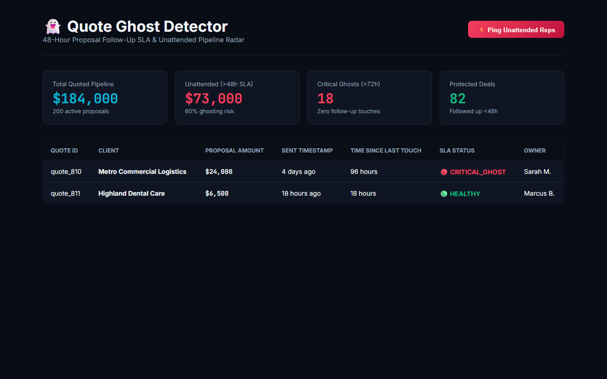

# Quote Ghost Detector (Weapon #05 in the Master 50 Arsenal)

> **48-Hour Proposal Follow-Up SLA & Unattended Pipeline Radar: Monitors open quotes, flags proposals sitting past 48 hours without follow-up, and quantifies unattended pipeline.**

[](test/quote-ghost.test.js)
[]()

---

## 🚀 Live Interactive Simulator & Proof

[](https://gideonbawa-website.netlify.app/simulators/quote-ghost-detector/)

* 🌐 **Live In-Browser Simulator:** [https://gideonbawa-website.netlify.app/simulators/quote-ghost-detector/](https://gideonbawa-website.netlify.app/simulators/quote-ghost-detector/)
* 💼 **Portfolio Showcase:** [https://gideonbawa-website.netlify.app/#work](https://gideonbawa-website.netlify.app/#work)
* 🛡️ **Verified QA Evidence:** HMAC-SHA256 Signed Contract (`ev-qa-contract-1791285928367-quote-ghost-detector`)

---


## 💸 Problem & Economic Pain
A business sends 200 quotes worth $184,000. 120 never receive a follow-up touch.
Prospects don't ghost because they hate the offer — they get busy, forget, and buy elsewhere unless guided to the finish line.

## 🏗️ Operational Flow
```text
PROPOSAL SENT (Stripe / PandaDoc / QBO Webhook)
  ↓
SLA CRON MONITOR (Enforces 48-hour follow-up deadline)
  ↓
GHOST IDENTIFIER (Flags quotes exceeding 48h without touch)
  ↓
MANAGEMENT ESCALATION (Quantifies unattended $ and alerts account rep)
```
